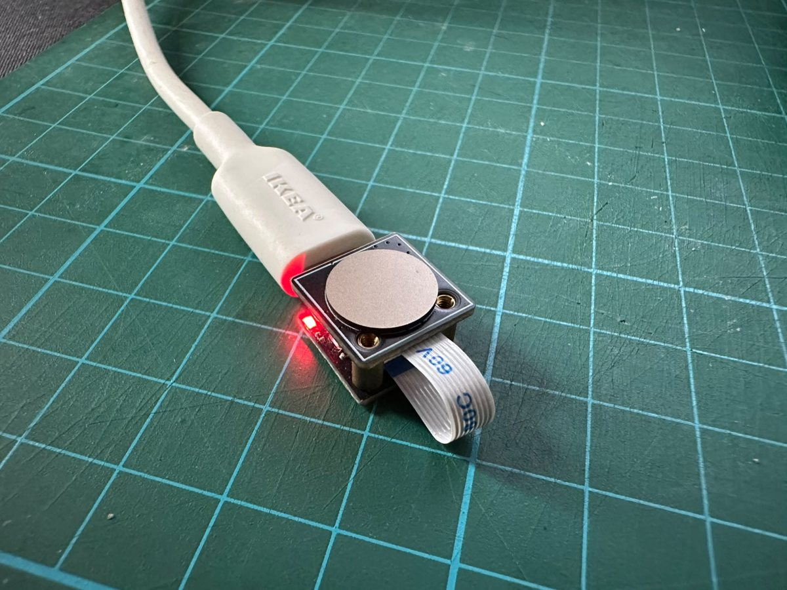

# PetaIC MOC libfprint driver

[](https://github.com/iewil/libfprint-petaic-moc/actions/workflows/ci.yml)

This project adds an experimental native [libfprint](https://gitlab.freedesktop.org/libfprint/libfprint) backend for the [WeAct/PetaIC USB fingerprint reader](https://www.aliexpress.com/item/1005012693895809.html?spm=a2g0o.order_list.order_list_main.4.4ca31802lES4b8) with USB ID `28e9:5159`. Testing used **Package 2** in that listing; other package variants have not been verified. The backend has been verified on Linux Mint with fprintd, Cinnamon PAM, and a real Cinnamon screen unlock.



*The Package 2 reader used for development and testing.*

The reader performs matching on-device. The current backend stores an authorization record that associates a cryptographically authenticated reader identity with a Linux account and finger name. It does not copy biometric templates to the computer.

## AI authorship

The code and documentation in this repository were created entirely by OpenAI Codex. I provided the hardware, captured protocol traffic, and performed the physical tests; but Codex did the implementation. The project remains experimental, and this AI-generated code should be used at your discretion..

## Current status

> **Help move this driver toward upstream libfprint.** The next step is independent verification on more Package 2 readers, other product variants, and Linux distributions. If you can help, please test clean installation, fresh-finger enrollment, repeat matching, rejection of an unenrolled finger, cancellation, and unplug/reconnect behavior, then report your reader package variant, distribution, and sanitized results in a GitHub issue. Do not attach fingerprint records, raw USB captures, device keys, or serial numbers. These results will help determine whether the driver is ready for an upstream merge request.

- fprintd enrolled an existing reader-side finger and verified it successfully.
- An unenrolled finger was rejected by both the native backend and fprintd.
- A non-touching PAM attempt timed out to the normal password prompt.
- A real Cinnamon screen lock was unlocked with the enrolled finger.
- Linux-driven enrollment of a fresh finger completed all 12 accepted samples, committed the reader-side template, and confirmed it by storage readback. The resulting libfprint print survived save/reload and matched on a subsequent live verification.
- The fprintd path saves fresh Linux prints. Verification may need several scan attempts: the reader can reject initial captures and authenticate a later one. Fresh enrollment and eventual matching have been confirmed on this reader; broader device/firmware testing remains open.
- Enrollment retries an image-quality rejection without advancing the accepted sample count. Live negative-match, cancellation, and reconnect checks remain part of validation.

This remains experimental software. The reader's model certificate expired on 2025-05-15. The installation therefore requires a local policy pin for the reader's model certificate, device public key, and firmware hash. The exception allows only that pinned expired model certificate; issuer validity, signatures, firmware attestation, and fresh session MACs remain checked. Certificate revocation policy, suspend/resume, unplug recovery, long-term reliability, and biometric false-accept rates have not been established. Read [the security and trust model](SECURITY.md) before installing it.

## Contents

- [Install and use](#install-and-use)
- [Build the Debian package](#build-the-debian-package)
- [Advanced source installation](#advanced-source-installation)
- [Security model and limitations](SECURITY.md)
- [Development and contribution guide](CONTRIBUTING.md)
- [Third-party notices](THIRD_PARTY_NOTICES.md)

## Install and use

These instructions target a 64-bit Linux Mint 22.x/Ubuntu 24.04 system with the `28e9:5159` reader. Only Package 2 of the linked product listing has been tested. The package uses an isolated libfprint library and does not replace the distribution's libfprint files.

### Download and install the package

Download the latest `libfprint-petaic-moc_*_amd64.deb` asset from [GitHub Releases](https://github.com/iewil/libfprint-petaic-moc/releases/latest). In a terminal, change to the download folder and install the exact filename you downloaded (replace `0.1.0` below with the version in that filename):

```sh
cd ~/Downloads
sudo apt install ./libfprint-petaic-moc_0.1.0_amd64.deb
```

Connect the reader and create its machine-specific trust pin with the packaged Python script:

```sh
sudo python3 /usr/libexec/petaic-moc/scripts/pin_native_reader.py \
  --pin \
  --output /etc/libfprint/petaicmoc/policy.ini \
  --cert-dir /usr/libexec/petaic-moc/certs/sdcp
sudo systemctl restart fprintd
```

Then [enroll and verify a finger](#enroll-and-verify). The package installs the native backend, required public certificates, USB access rule, and fprintd library path. It does not enroll a finger or enable PAM. If no release is available yet, use the separate package-building instructions below.

### Optional: enable Cinnamon lock-screen authentication

Install the standard fprintd PAM module if it is not already installed, and keep your current desktop session open while testing this change:

```sh
sudo apt install libpam-fprintd
```

After enrolling a finger, back up Cinnamon's PAM configuration. If the file does not contain the expected `@include common-auth` entry, stop and check the Linux Mint PAM layout before editing it:

```sh
sudo cp -a /etc/pam.d/cinnamon-screensaver /etc/pam.d/cinnamon-screensaver.petaic-moc-backup
sudoedit /etc/pam.d/cinnamon-screensaver
```

Add this line at the top of the file, before `@include common-auth`:

```text
auth sufficient pam_fprintd.so max-tries=1 timeout=10
```

Test fingerprint unlock and password fallback with a real Cinnamon screen lock before logging out. The `sufficient` rule lets authentication continue to the normal password path when the fingerprint is not accepted. To undo the change, restore the backup:

```sh
sudo cp -a /etc/pam.d/cinnamon-screensaver.petaic-moc-backup /etc/pam.d/cinnamon-screensaver
```

## Build the Debian package

These steps are for contributors who want to build the installable `.deb` themselves. They build the backend, run its native tests, and create the package under `dist/`; they do not install it or require the fingerprint reader to be connected. End users can skip this section and install the release package above.

Clone the repository and install the build and packaging tools:

```sh
git clone https://github.com/iewil/libfprint-petaic-moc.git
cd libfprint-petaic-moc
sudo apt update
sudo apt install build-essential dpkg-dev fprintd git ninja-build pkg-config python3 python3-dev meson libglib2.0-dev libssl-dev libusb-1.0-0-dev libgusb-dev libjson-glib-dev libcairo2-dev
```

Build and test the driver, then assemble the Debian package:

```sh
python3 scripts/build_native.py --clean
python3 scripts/package_deb.py --version 0.1.0
(cd dist && sha256sum *.deb > SHA256SUMS)
```

The generated `.deb` and checksum are in `dist/`. To publish a release after independent hardware verification, push a version tag such as `v0.1.0`; GitHub Actions rebuilds and tests that revision, then attaches the package and checksum to a GitHub release.

## Advanced source installation

This path is for development or systems without a packaged release. It builds the driver and installs it directly instead of creating a `.deb`.

### Install source-build tools

The helper downloads and extracts the Ubuntu `libgusb`, `libusb`, `libjson-glib`, and Meson development packages into the ignored `build/` directory, without installing them system-wide. It keeps its pinned libfprint checkout and build output there as well. The build pins upstream libfprint to commit `6f9479c3d55f847c1b3769f28ceb99227f9858cf`, overlays this backend, builds only the PetaIC driver, and runs the focused native protocol/policy tests.

```sh
sudo apt update
sudo apt install build-essential git ninja-build pkg-config python3-venv python3-pip libglib2.0-dev libssl-dev libusb-1.0-0 acl
python3 -m venv .venv
.venv/bin/python -m pip install -r requirements.txt
python3 scripts/build_native.py --fetch-deps --clean
```

Use `--clean` to recreate only the generated native build directory before rebuilding.

### Validate certificates and pin the reader

The verified public SDCP certificate chain is included in `certs/sdcp/`, with provenance and expected SHA-256 digests in its README. The installer checks these hashes before copying the certificates into its root-owned runtime trust directory. A reader-specific key and firmware pin stays local to each machine; no Windows driver package is needed.

Connect the reader and grant your account access to its USB node until the reader is reconnected:

```sh
python3 scripts/grant_usb_access.py
```

Then verify its live attestation and create the exclusive, mode-0600 local policy:

```sh
.venv/bin/python scripts/pin_native_reader.py --pin
```

The command accepts only the expired model-certificate condition observed on the tested hardware. It refuses other certificate-chain validity errors and pins this reader's model certificate, device key, and current firmware. The policy is stored in the ignored `build/petaicmoc-work/private/` directory. Keep this per-machine policy private.

### Build, review, and install

Build the production overlay, then run the installer in preview mode:

```sh
python3 scripts/build_native.py
python3 scripts/install_native.py
```

The preview checks the build manifest and hashes, ABI compatibility with installed fprintd, library runtime paths, certificate pins, and local policy. Review its output before installing. To install the staged library, root-owned pin and certificates, fprintd service override, and udev rule:

```sh
sudo python3 scripts/install_native.py --install
```

For a later rebuild on a machine that already has this backend, use `sudo python3 scripts/install_native.py --update`. It verifies the installed files and symlinks before replacing the backend library; local policy, certificates, diagnostics, and PAM settings are retained.

### Enroll and verify

Installing the native backend does not enroll an account or enable PAM. As your regular desktop user, enroll a new finger directly on the reader and verify it:

```sh
fprintd-enroll -f right-index-finger "$USER"
fprintd-verify -f right-index-finger "$USER"
```

Confirm that the enrolled finger matches and an unregistered finger is rejected. Keep a password fallback available. Enrollment and matching have been tested on one reader and firmware; broader hardware/firmware compatibility, cancellation, and long-term reliability remain unverified. Verification may take several scan attempts because the reader can reject initial captures before authenticating a later one.

### Enable Cinnamon lock-screen authentication

PAM integration is a separate, optional step. It changes only Cinnamon's screensaver PAM entry and retains the existing password path:

```sh
sudo python3 scripts/install_native.py --enable-unlock
```

Run the PAM checks and then test a real Cinnamon screen lock:

```sh
python3 scripts/check_screensaver_pam.py
python3 scripts/check_screensaver_pam.py --expect-fallback
cinnamon-screensaver-command --lock
```

The first check waits for the enrolled finger. The fallback check waits without a touch and stops at the password prompt. Verify both fingerprint unlock and normal password unlock when the reader is unavailable or does not recognize a finger.

### Remove

For a `.deb` installation, remove the package with:

```sh
sudo apt remove libfprint-petaic-moc
```

Package removal leaves local reader-pin data and any manual PAM edits in place. If you enabled Cinnamon unlock, restore your PAM backup before removing the package. Delete the local pin manually only if you also want to remove this reader's trust record: `sudo rm /etc/libfprint/petaicmoc/policy.ini`.

For a source installation, the managed rollback restores Mint's packaged libfprint selection and original Cinnamon PAM file if unchanged:

```sh
sudo python3 scripts/install_native.py --remove
```

The Linux fprintd print remains in the user's fprintd storage. Remove only that finger's Linux authorization record with `fprintd-delete -f right-index-finger "$USER"` while the reader backend is available. Project cleanup does not delete hardware database records.

## License

The original project code is provided under the GNU Lesser General Public License, version 2.1 or (at your option) any later version. See [LICENSE](LICENSE). Upstream libfprint and other dependencies retain their own licenses; see [THIRD_PARTY_NOTICES.md](THIRD_PARTY_NOTICES.md).
